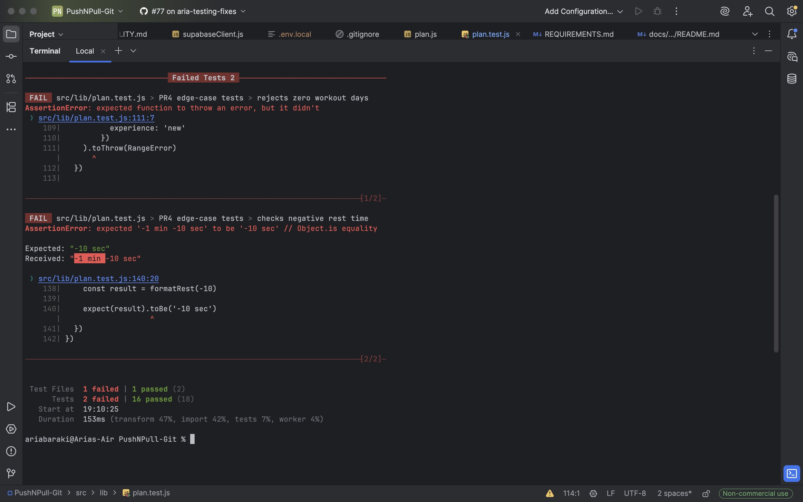
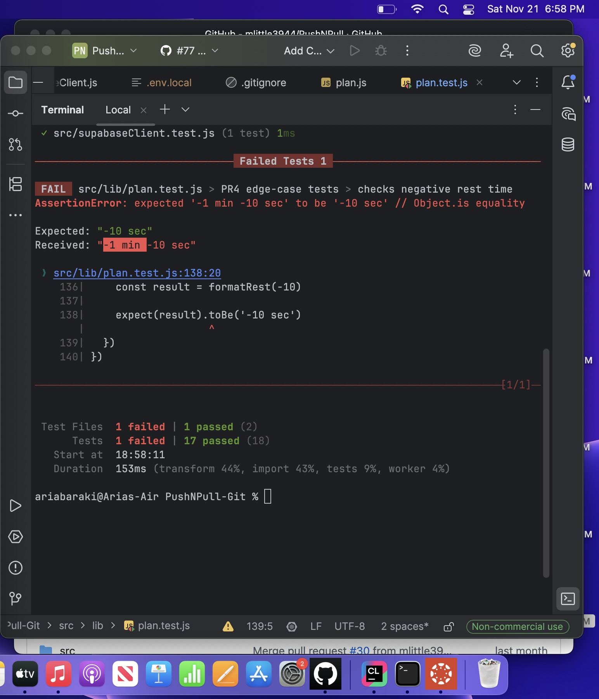
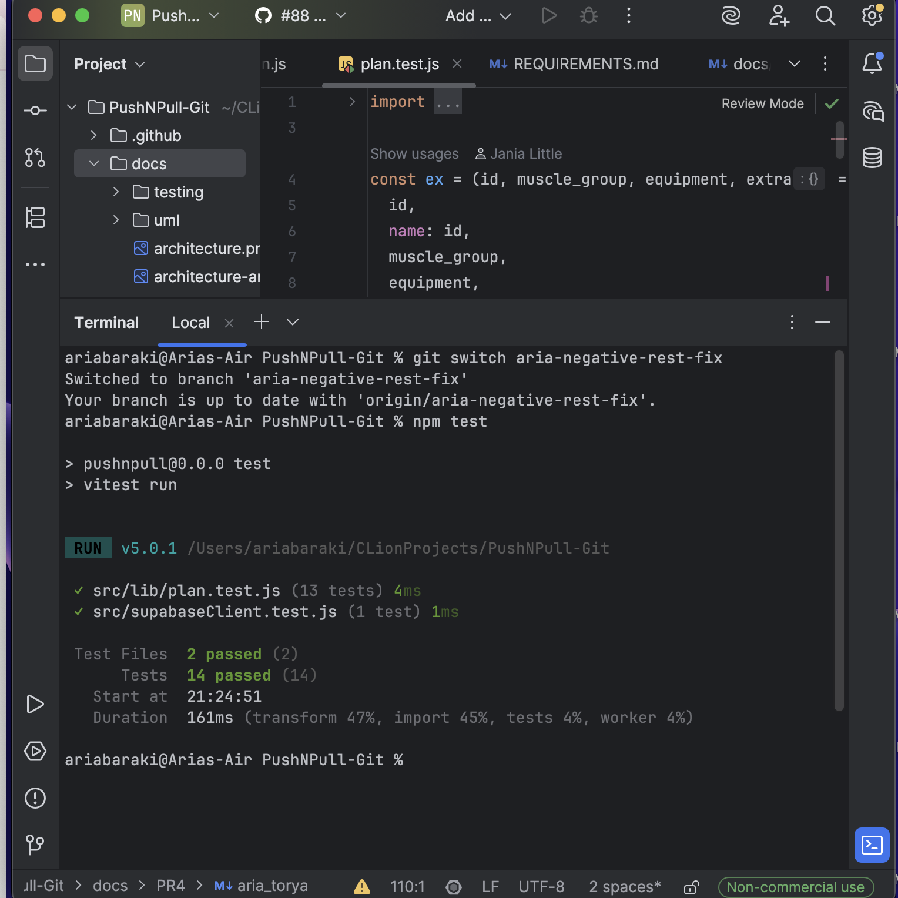

# Aria Toryalai
## CS 250 — PR4 Individual Report

## Bug Fix 1: Issue #86 — Invalid Workout Days

**GitHub Issue:** https://github.com/mlittle3944/PushNPull/issues/86

**Pull Request:** https://github.com/mlittle3944/PushNPull/pull/77

**Bug Type:** Code bug.

**Problem:**
The workout planner accepted invalid numbers of workout
days, including 0, -1, and 7.

**How I found it:**
I added edge-case tests and ran npm test.
The function returned a workout instead of rejecting
invalid input.

**How I fixed it:**
I updated pickRoutineId() in src/lib/plan.js
to throw a RangeError for workout days outside 2–6.

**Testing:**
The invalid workout-day tests passed after the fix.

### Before Fix

### After Fix

## Bug Fix 2: Issue #87 — Negative Rest Time

**GitHub Issue:** https://github.com/mlittle3944/PushNPull/issues/87

**Pull Request:** https://github.com/mlittle3944/PushNPull/pull/88

**Bug Type:** Code bug.

**Problem:**
The formatRest() function displayed -10 seconds
as "-1 min -10 sec" instead of "-10 sec".

**How I found it:**
I added a negative rest-time test and ran npm test.
The test failed because the formatted result was wrong.

**How I fixed it:**
I updated formatRest() in src/lib/plan.js
to handle negative seconds correctly.

**Testing:**
After the fix, all 14 tests passed on my
aria-negative-rest-fix branch.

### Before Fix

### After Fix

