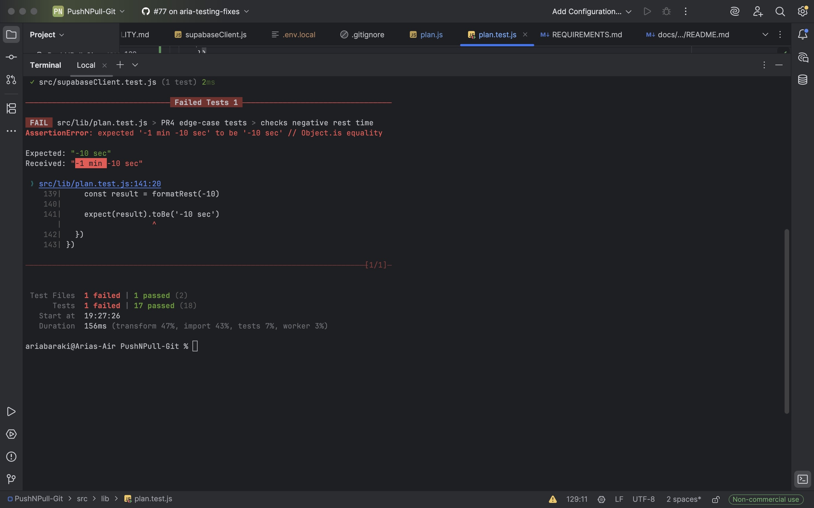

# Aria Toryalai

## Bug Fix 1: Issue #86 — Invalid Workout Days

**GitHub Issue:** https://github.com/mlittle3944/PushNPull/issues/86

**Pull Request:** Not created yet.

**Problem:**
The workout planner accepted invalid numbers of workout days, such as 0, -1, and 7.

**Bug Type:** Code bug.

**How I found it:**
I added edge-case tests and ran `npm test`. The zero-workout-days test failed because the function returned a workout instead of rejecting the invalid input.

**How I fixed it:**
I updated `pickRoutineId()` in `src/lib/plan.js` to throw a RangeError when the number of workout days is outside 2–6.

**Testing:**
After the fix, the zero, negative, and seven-day validation tests passed. The full test run had 17 passing tests and one unrelated failing test for negative rest time.

### Before Fix

### After Fix

## Bug Fix 2

Not completed yet.