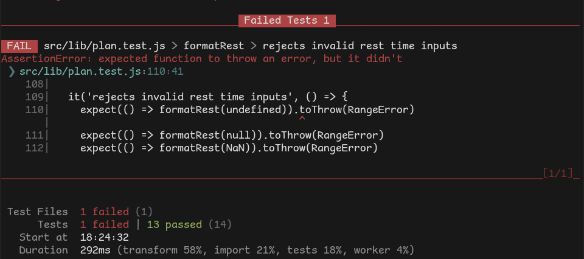
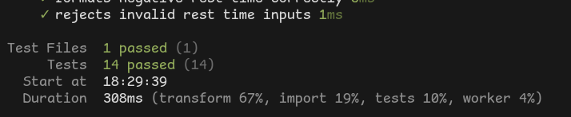
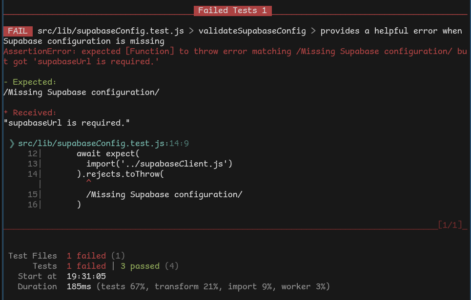
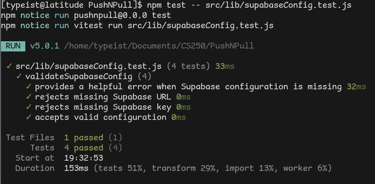

# Chris Jahner

**Team:** 10  
**Project:** PushNPull  
**Sprint:** PR4

## Bug Fix 1 — Invalid Rest-Time Inputs (Issue #92)

**GitHub Issue:** [#92 — `formatRest()` accepts invalid rest-time inputs](https://github.com/mlittle3944/PushNPull/issues/92)  
**Pull Request:** [#93 — Fix invalid rest time inputs](https://github.com/mlittle3944/PushNPull/pull/93)** 
**Files:** `src/lib/plan.js`, `src/lib/plan.test.js`

**Before:**  

**After:**  

**Bug classification:** Code bug. The existing `formatRest()` function tried to do math on invalid inputs such as strings and null values.

**Fix and verification:** I added an edge case test for range errors on formatRest that expects an error to be thrown then an invalid input is given. Then I added in input verification to the beginning of `formatRest()` so it throws errors on invalid inputs.

## Bug Fix 2 — Blank Page Without Supabase Configuration (Issue #72)

**GitHub Issue:** [#72 — App shows a blank page when Supabase configuration is missing](https://github.com/mlittle3944/PushNPull/issues/72)  
**Pull Request:** **[#95](https://github.com/mlittle3944/PushNPull/pull/95)**  
**Files:** `src/supabaseClient.js`, `src/main.jsx`, `src/lib/supabaseConfig.test.js`

**Before:**  

**After:**  

**Bug classification:** Code bug. When the supabase env variables were not present, the error was thrown before React could render anything, leaving the user with a blank page.

**Fix and verification:** I added a test case that reproduces the missing config error, and checks for a useful message displayed to the user. Then I added a supabaseClient.js file that checks the enviornment variables for a supabase config, and display a descriptive error to the user if they are missing.

