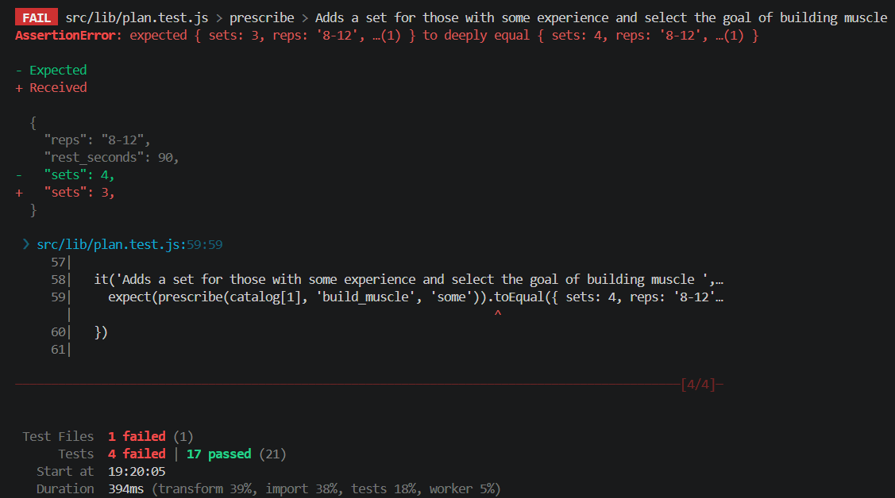
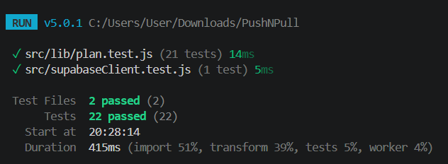

# Daniel Elias

## Test Case Correction from Step 1 - Run and Sort
**Reasoning** I mistook the console log information for being a test bug so instead of fixing it, I would to void it which I did by closing its respective issue [Issue #83](https://github.com/mlittle3944/PushNPull/issues/83) and editing its test case below. 
### DE-04 
**Test ID:** DE-04
**From Part 6:** New
**Written by:** Daniel Elias
**Title:** Testing user data security by attempting to access their onboarding questions located in the profiles table while logged out. 
**Traces to:** NFR-DE-01
**Test type:** Security
**Preconditions:** A user has been created and signed in. The user has completed the onboarding form at least once to store the data in the profile table. The corresponding onboarding answers have been saved into the profiles table in Supabase (copy the migration and seed sql schema to the sql editor in supabase for replicability). The tester has access to a web browser with a console. Have the repo cloned with  access to the workout.jsx and the src/pages directory. 

**Test data:**
profiles table: { id: "b7339e56-11d5-426f-b6f7-b1cfa145f40a", created_at: "2026-11-16T03:27:45.519003+00:00", display_name: "Daniel", goal: "build_muscle", experience: "new", days_per_week: 4, equipment: bodyweight, routine_id: "upper_lower_4", onboarded_at: "2026-11-16T01:10:12.88+00:00" }

**Steps:**
1. Go the src/pages directory and create a new file called profileTest.js
2. Place the following code inside the newly created file: 
```
import { supabase } from '../supabaseClient'

async function viewProfiles() {
  const { data, error } = await supabase
    .from('profiles')
    .select('*')

  if (error) {
    console.error('Test profiles were not loaded:', error)
    return
  }

  console.log('First profile:', data?.[0])
  
}
viewProfiles()

```
3. Import the function to the workout.jsx file by placing this as the first line in the file: `import './profileTest.js'`
4.  Make sure that you are at the workout hub that is layed out in the home.jsx
5. Refresh the web broswer
6. Press F12 and then go to the console log to see if you can see the user's profile data. 
7. Sign out 
8. Run `viewProfiles()` in the console prompt on the web browser
9. See if the user's onboarding data is still visible

**Expected result:** The user's profile information isn't able to be accessed when they are signed out from the website.
**Actual result:** The user sees an undefined object in the console log with none of the user's profile data. 
**Status:** Pass
**Severity:** N/A
**V or V:** Verification
**GitHub Issue:** N/A

---

## Bugs Fixed

**Issue:** https://github.com/mlittle3944/PushNPull/issues/90

**Pull Request:** https://github.com/mlittle3944/PushNPull/pull/97

**Before Fix:**



**After Fix:**



**Explanation:**  
This was a code bug that was confirmed by the team as a validation bug that doesn't require having to add values in the exercise table. 

**AI Disclosure**
-Used AI to help format this markdown file
-Used AI to trace and implement what code I had to change after the prescribe function in plan.js. This includes this code `profile?.experience` buildPlan() function in plan.js, `${routineId}|${profile.goal}|${profile.experience}|...` in the usePlan() method in usePlan.js, and `this.#profile.experience` in the buildPlan() method in planBuilder.js. 
-Used AI to create the edit the planTest.js to accurately test if my fixes work
-Used AI for formatRest() function.

---

### Issue #[NUMBER] – [SECOND BUG TITLE]

**Issue:** [GitHub Issue link]  
**Pull Request:** [GitHub PR link]  

**Description:**  
[Briefly explain the second bug.]

**Before Fix:**


**After Fix:**


**Explanation:**  
This was a code bug because [explain how the test demonstrated the problem]. I fixed it by [briefly explain your solution].

---

## AI Disclosure
-Used AI to help format this markdown file
-Used AI to trace and implement what code I had to change after the prescribe function in plan.js. This includes this code `profile?.experience` buildPlan() function in plan.js, `${routineId}|${profile.goal}|${profile.experience}|...` in the usePlan() method in usePlan.js, and `this.#profile.experience` in the buildPlan() method in planBuilder.js. 
-Used AI to create the edit the planTest.js to accurately test if my fixes work
-Used AI for formatRest() function.
