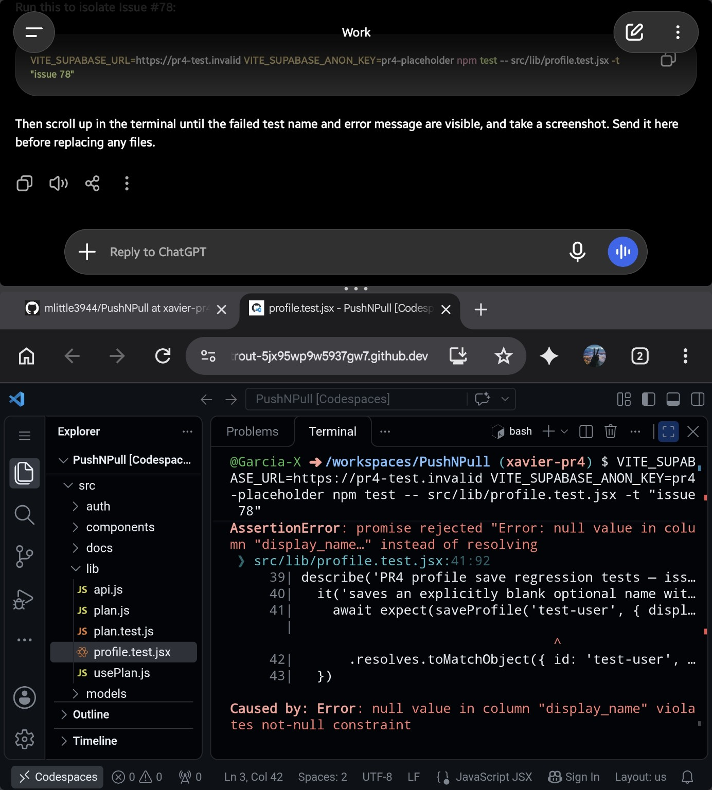
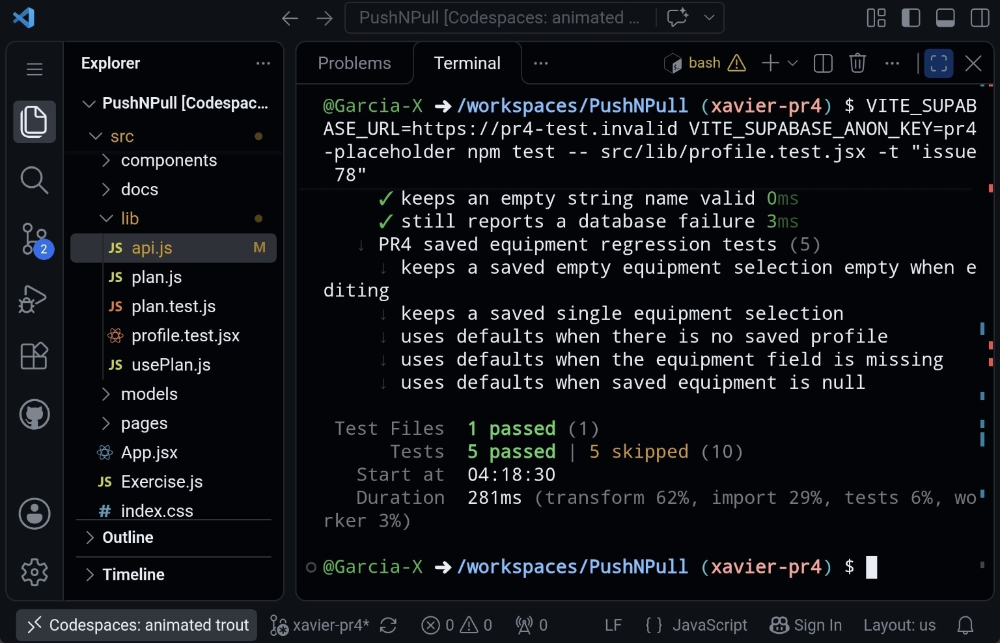
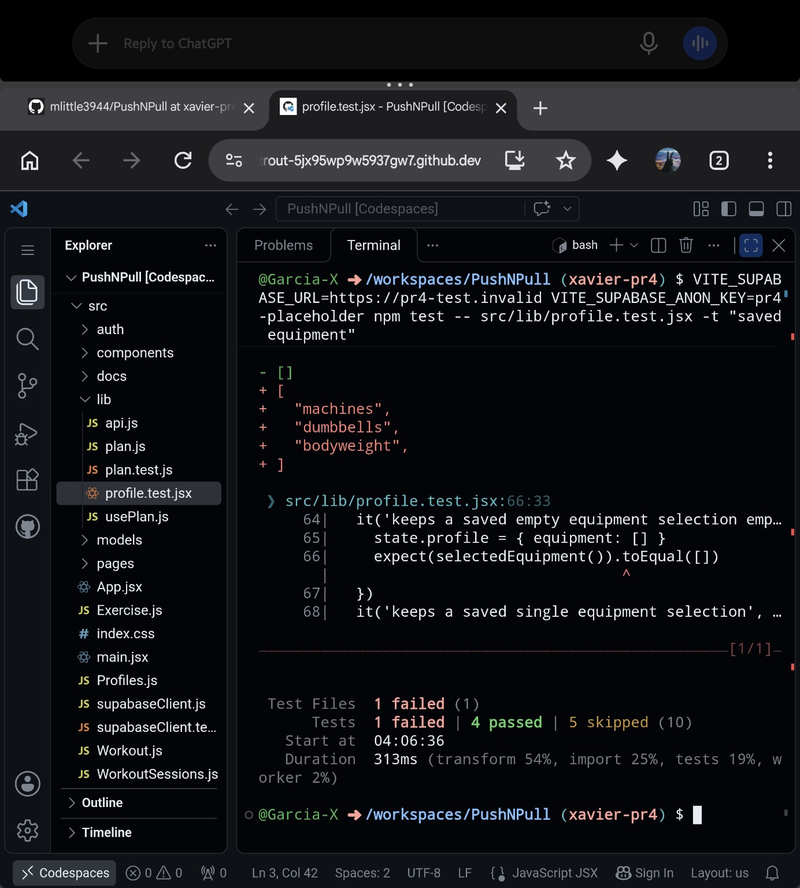
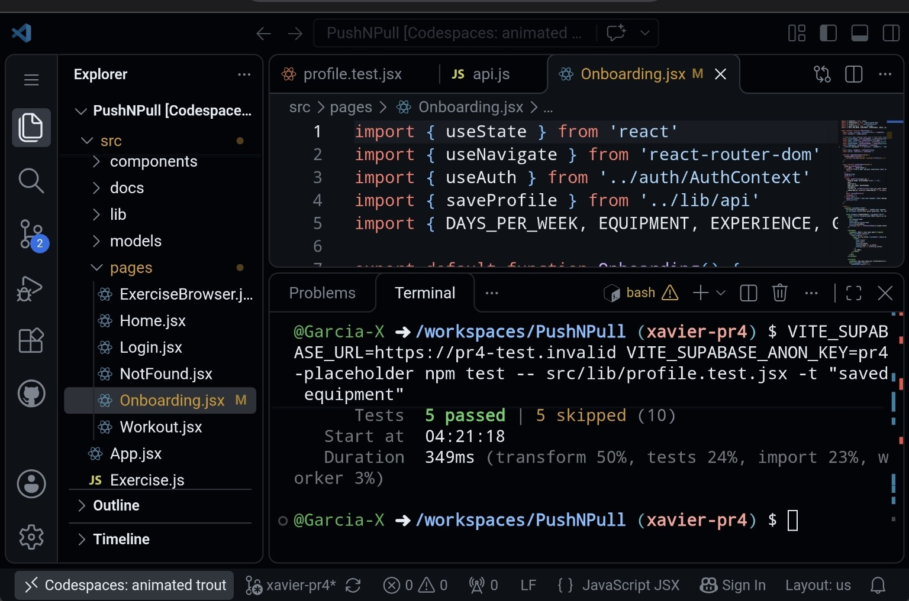

# Xavier Garcia

## PR4 — Bug Fixes and Regression Testing

**Team:** 10  
**Area:** User Profile  
**Branch:** xavier-pr4  
**Pull request:** https://github.com/mlittle3944/PushNPull/pull/98

## Bug 1: Optional display name prevents profile saving

**Issue:** https://github.com/mlittle3944/PushNPull/issues/78  
**PR:** https://github.com/mlittle3944/PushNPull/pull/98

**Classification:** Code bug. The form labels the display name as optional, but submitting a blank name sends null, which the inherited database rejected during earlier manual testing.

**Before:** The automated regression test reproduced the rejection using a mock of the database's not-null constraint. The targeted run had 1 failed test and 4 passing tests.

**Fix:** Updated saveProfile() in src/lib/api.js to convert an explicit null display name to an empty string. Updates that omit the display name leave that field out of the request.

**After:** All 5 targeted tests passed. These also check that entered names are preserved, omitted names are not added to partial updates, empty strings are accepted, and database errors are still reported.

### Before screenshot

### After screenshot

## Bug 2: Empty equipment selections are replaced with defaults

**Issue:** https://github.com/mlittle3944/PushNPull/issues/95  
**PR:** https://github.com/mlittle3944/PushNPull/pull/98

**Classification:** Code bug. The form should display the saved equipment selections, but rendering it with an empty saved array selected machines, dumbbells, and bodyweight instead.

**Before:** The targeted test expected no selected equipment but received the three default selections. The run had 1 failed test and 4 passing tests.

**Fix:** Updated the equipment state initialization in src/pages/Onboarding.jsx to use defaults only when saved equipment is null or missing.

**After:** All 5 targeted tests passed. An empty saved selection stays empty, a single saved selection is preserved, and profiles with missing or null equipment still receive the defaults.

### Before screenshot

### After screenshot

## Regression Results

I ran the tests in GitHub Codespaces through Chrome on my Android phone.

| Stage | Passed | Failed |
|---|---:|---:|
| Existing automated suite | 19 | 0 |
| After adding 10 profile tests, before fixes | 27 | 2 |
| After fixing issue 78 | 28 | 1 |
| After fixing both bugs | 29 | 0 |

The full automated suite passed across 3 test files after both fixes. The production build also passed. No previously passing automated test failed during these checks.

The new tests are in src/lib/profile.test.jsx. They use mocked profile data and database responses, not a live Supabase connection. Live application retesting remains pending.

These results are from my branch. Teammate approval, merging, and the required full-suite run on main after merging remain pending.

## AI Use

I used ChatGPT to help write the regression tests, explain and prepare the fixes, and organize this report; I ran the tests in Codespaces and captured the screenshots.
