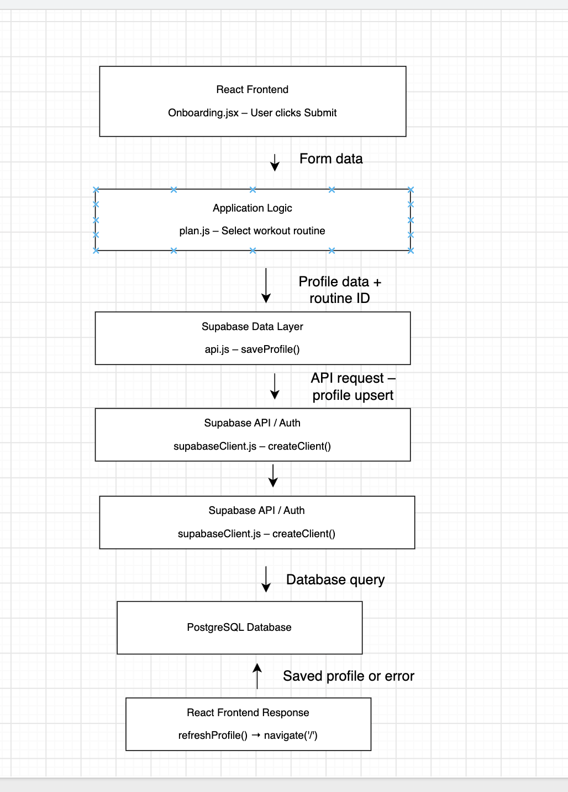
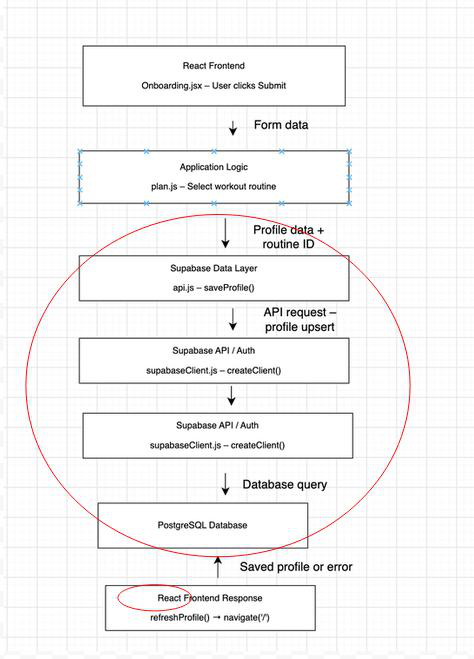

Team Name: Group 10

Inherited Project: PushNPull

Each of the four members owns one part of the map. Everyone reads code. Nobody spectates.

| Role | Owns | Specific task | Name |
| --- | --- | --- | --- |
| Product Analyst | Part 1 and the questions in Part 4 | Runs the app, picks the user action, writes the purpose sentence, and collects the team’s three questions for the original team. | Aria |
| Architect | Part 2 and the mismatches in Part 4 | Draws the as-built diagram from the code, then compares it to the handoff UML and records every mismatch. | Daniel  |
| Frontend Tracer | Part 3, client side | Traces the action from the button click to the request leaving the client. Every row gets a file path. | Xavier |
| Backend Tracer | Part 3, server side | Traces from the API route to the database and back to the response. Every row gets a file path. | Chris |

The two Tracers must meet at the same API endpoint. If your halves don’t connect, your trace is wrong.

## Part 1: Purpose

In one sentence: what does this system do, and for whom? Be specific. "It's a web app for users" is not an answer.

This system lets gym beginners create an account and receive a personalized workout plan based on their fitness goals, experience, and equipment.

User action we will trace: (for example, "create an account" or "submit a post". It must touch the backend and the database.)

The user completes the onboarding form by choosing a fitness goal, experience level, workout days per week, and available equipment, then clicks Submit.

We will follow how the application handles this information, sends it to Supabase, saves the profile, and returns the user to their workout plan.

## Part 2: As-built architecture diagram

Draw boxes and arrows for every major component. Draw only what the code proves exists. Label each arrow with what travels along it (HTTP request, SQL query, event, file).

PushNPull uses React for its frontend and Supabase for its backend services and PostgreSQL database. When the user submits the onboarding form, the application chooses a workout routine and sends the profile information to Supabase. Supabase saves the information in the database and returns the result. The application then updates the user's profile and takes them to their workout plan. GitHub Actions is used for automated testing, and Vercel is used for hosting.

## Part 3: Trace the click

Follow your one user action from the button click to the database and back. Minimum five hops. Every row needs a real file path and function name. Add rows as needed.

Example (create a user profile). Rows 1 and 2 belong to the Frontend Tracer. Rows 3 to 7 belong to the Backend Tracer. They meet at `POST /api/profiles`.

| Step | Layer | File and function | Data in / data out | Notes or surprises |
| --- | --- | --- | --- | --- |
| 1 | Frontend | `client/src/pages/CreateProfile.jsx` → `handleSave()` | Form state → calls `createProfile(data)` | Photo uploads to image storage before Save |
| 2 | Frontend | `client/src/api/profiles.js` → `createProfile()` | Profile object → `POST /api/profiles` with JWT |  |
| 3 | API route | `server/routes/profiles.js` → `router.post('/')` | JSON body → passed to auth middleware |  |
| 4 | Middleware | `server/middleware/auth.js` → `requireAuth()` | JWT → `req.user.id` | Token expiry is never checked |
| 5 | Backend logic | `server/controllers/profileController.js` → `createProfile()` | Body + user id → validated profile | Bio length is not validated |
| 6 | Database | `server/models/Profile.js` → `Profile.create()` | Profile → `INSERT INTO profiles`, returns id | Interests saved as one comma-separated string |
| 7 | Response | `profileController.js` → `res.status(201).json()` | New profile → client redirects to `/profile/:id` |  |

Your trace:

| Step | Layer | File and function | Data in / data out | Notes or surprises |
| --- | --- | --- | --- | --- |
| 1 | Frontend | `src/pages/Onboarding.jsx`→`handleSubmit(event)` | Form submission → reads display name, goal, experience, days per week, and equipment. | Stops the page reload. Missing goal or experience displays an error. The button is disabled while saving. |
| 2 | Frontend logic | `src/lib/plan.js`→ `pickRoutineId()` | Days per week and experience → routine ID. | Selection runs in the browser. Goal and equipment affect the plan later. |
| 3 | Client API call | `src/pages/Onboarding.jsx`→`handleSubmit(); src/lib/api.js`→ `saveProfile()` | User ID + form answers → id, display_name, goal, experience, days_per_week, equipment, routine_id, onboarded_at. | Trims the display name and preserves an existing onboarding timestamp. |
| 4 | Request to backend | `src/lib/api.js`→`saveProfile(); src/supabaseClient.js`→ `createClient()` | Profile object → Supabase profiles request using upsert(...).select().single(). | Calls Supabase directly, without a custom server route. Upsert inserts or updates the profile. |
| 5 | Database | `supabase/migrations/20261007000000_initial_schema.sql`→`public.profiles and its policies` | Profile data → stored row, subject to constraints and access policies. | SQL definitions, not a JavaScript function. Defines auth.uid() = id ownership rules and valid field values. Live deployment is unverified. |
| 6 | Response back | `src/lib/api.js`→`saveProfile()` | Supabase data/error → saved profile or thrown error. | The caller waits for success but does not use the returned row. It reads the profile again. |
| 7 | Refresh profile | `src/auth/AuthProvider.jsx → refreshProfile(); src/lib/api.js`→`getProfile()` | User ID → select by id with maybeSingle() → profile state updated by setProfile(fresh). | Makes a second database request to refresh shared application state. |

## Part 4: Reality check and open questions

Open the handoff UML and compare it to your diagram. Circle every mismatch on your diagram.

What the handoff docs got wrong or left out:

The handoff docs say that there are no security rules setup, but in another section also says that Row Level Security is turned on in the database and users can only access rows belonging to them.

Three questions for the original team. For each, note whether it is about intent ("was this on purpose?") or design ("why is it built this way?").

1. **(Design)** Why did you choose Supabase instead of creating a separate backend server?

2. **(Intent)** Were the model classes in the UML diagrams supposed to be used in the application, or were they only for the design?

3. **(Design)** Why does the handoff document mention missing security rules when the database migration includes security policies? Which one should we follow?

## Grading checklist

- [ ] Purpose sentence is specific, not generic

- [ ] Diagram matches the code, not the handoff docs

- [ ] Trace has at least five hops, each with a file path

- [ ] At least one doc-vs-reality mismatch is identified

- [ ] Three real questions for the original team

- [ ] Every role has a named owner, and the two trace halves meet at the same endpoint.

## Part 5: Candidate requirements

Requirements were identified from `src/lib/plan.js`.

| ID | Candidate requirement | Type | Source | Status | Acceptance criterion |
| --- | --- | --- | --- | --- | --- |
| CR-1 | The system shall select the full-body routine for a user who chooses three workout days per week. | Functional | `src/lib/plan.js` → `pickRoutineId()`; trace row 2 | Confirmed | Input `{ days_per_week: 3, experience: "some" }` returns `"full_body_3"`. |
| CR-2 | The system shall keep prescribed rest periods at a minimum of 30 seconds when adjusting an exercise for general fitness. | Functional | `src/lib/plan.js` → `prescribe()` | Confirmed | An exercise with a 45-second rest period receives a 30-second rest period for `"general_fitness"`. |
| CR-3 | The system shall preserve the original prescription for timed exercises. | Functional | `src/lib/plan.js` → `prescribe()` | Confirmed | An exercise with 3 sets, `"20-40 sec"` repetitions, and 60 seconds of rest retains those values for `"get_stronger"`. |
| CR-4 | The system shall reject a workout frequency outside the supported range of two to six days per week. | Functional | `src/lib/plan.js` → `DAYS_PER_WEEK`, `pickRoutineId()`; the function lacks this validation. | Unconfirmed | Proposed: input `{ days_per_week: 0, experience: "some" }` throws a `RangeError` with the message `"Workout days must be between 2 and 6."`. |
| CR-5 | The system shall exclude exercises already selected for the same workout day. | Functional | `src/lib/plan.js` → `chooseExercise()`; its fallback can return an already-used exercise. | Suspected bug | If an exercise is already in `used` and no unused alternative exists, the resulting workout does not contain a second occurrence of that exercise. |

## Part 6: Three unit test cases

Test results are predicted from code inspection. These tests have not been run.

| ID | Requirement | Kind | Unit under test | Input | Expected output | Predicted result today |
| --- | --- | --- | --- | --- | --- | --- |
| TC-1 | CR-1 | Positive | `src/lib/plan.js` → `pickRoutineId()` | `{ days_per_week: 3, experience: "some" }` | `"full_body_3"` | Pass: three days selects the full-body routine. |
| TC-2 | CR-2 | Boundary | `src/lib/plan.js` → `prescribe()` | Exercise: `{ sets: 3, reps: "8-12", rest_seconds: 45, is_compound: false }`; goal: `"general_fitness"` | `{ sets: 3, reps: "12-15", rest_seconds: 30 }` | Pass: subtracting 15 seconds reaches the 30-second minimum exactly. |
| TC-3 | CR-4 | Negative | `src/lib/plan.js` → `pickRoutineId()` | `{ days_per_week: 0, experience: "some" }` | Throws `RangeError("Workout days must be between 2 and 6.")` | Fail: the current function returns `"full_body_3"` instead of rejecting zero. |

TC-3 checks a proposed requirement. Zero workout days is outside the choices offered by the form, but the routine-selection function accepts it. The intended rejection behavior still needs confirmation.
